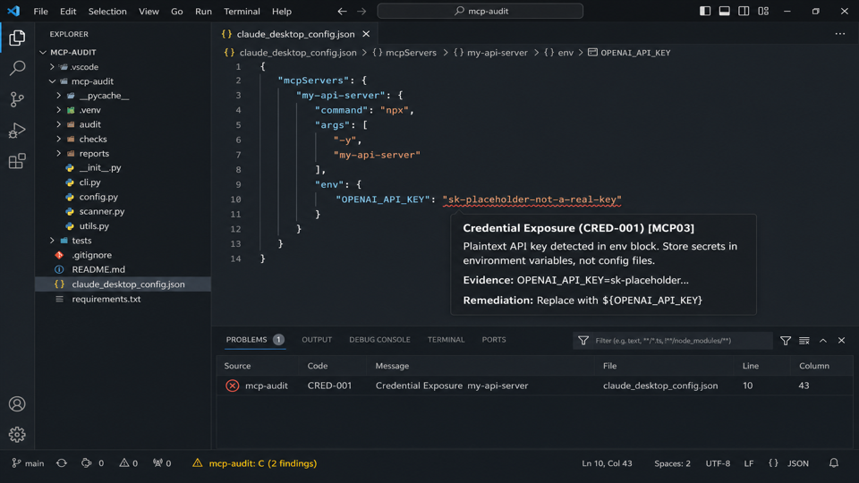

# Credenzo — VS Code / Cursor Extension

[](https://open-vsx.org/extension/mcp-audit/mcp-audit-vscode)
[](LICENSE)

> **mcp-audit is now Credenzo.** The extension id (`mcp-audit.mcp-audit-vscode`), the command ids and the `mcp-audit.*` settings keep their names, so an installed extension and your settings continue to work.

**Inline security diagnostics for [MCP](https://modelcontextprotocol.io/) server configuration files, powered by [Credenzo](https://credenzo.io).**

Red and yellow squiggles appear directly on vulnerable server keys in `claude_desktop_config.json`, `mcp.json`, and other MCP config files — the same findings `credenzo scan` reports, shown inline without leaving your editor.



---

## How to use

### Step 1 — Install Credenzo

The extension runs the `credenzo` command (or `mcp-audit`, its old name, when only that is installed). Install it first:

```bash
pip install credenzo
```

Or download a standalone binary for macOS, Linux, or Windows from the [Releases page](https://github.com/adudley78/mcp-audit/releases).

### Step 2 — Install this extension

In Cursor, Windsurf or VSCodium, search for **Credenzo** in the Extensions panel (the extension is on Open VSX). In VS Code, install from the terminal:

```bash
code --install-extension mcp-audit.mcp-audit-vscode
```

### Step 3 — Open an MCP config file

Open any supported config file. Diagnostics appear automatically within 3 seconds. No configuration required.

---

## What you get

| Feature | Detail |
|---|---|
| **Squiggles** | Red (CRITICAL/HIGH) or yellow (MEDIUM) underlines on offending server keys |
| **Hover cards** | Finding title, severity, description, evidence, remediation, OWASP MCP Top 10 tags |
| **Status bar** | `Credenzo: B (3 findings)` — click to open the Problems panel |
| **Problems panel** | All findings listed with source `credenzo` and finding ID (e.g. `CRED-001`) |
| **Auto-scan** | Scans on open and on save (both configurable) |
| **Registry verdicts** | An inline badge and a hover on each server that starts a registry package: verified or not, recorded CVEs, typosquat suspicion, malicious-package record (needs Credenzo 0.33.0 or later) |

---

## Registry verdicts

The extension finds the package that each server installs when it starts, and asks `credenzo vet` about that package. The server key gets an inline badge:

| Badge | Meaning |
|---|---|
| `✓ verified · 0 known CVEs (Anthropic)` | The package is in the Credenzo registry and is verified. No CVE is recorded |
| `✓ verified · 2 recorded CVEs, fixed in a later release` | CVEs are recorded and each has a fix. The entry pins no version, so the extension does not say which release you run |
| `• in registry, not verified · 0 known CVEs` | The package is in the registry. Its publisher is not verified |
| `⚠ 6 known CVEs affect this version — CVE-…` | The entry pins a version, and recorded CVEs affect it. A Warning goes to the Problems panel |
| `⚠ 1 known CVE with no fix recorded — CVE-…` | The entry pins no version, and a recorded CVE has no fix. Warning |
| `⚠ possible typosquat — did you mean …?` | The name is close to a registry name. Warning |
| `✖ malicious package record — MAL-…` | OSV lists a release of this package as malicious. Error |
| `? not in registry — no verdict available` | The registry has no entry. This is not a finding |

The hover shows the package name, the declared capabilities, and a link to the page of the package on [credenzo.io](https://credenzo.io) when it has one.

### Which servers get a badge

A server gets a badge when its `command` is `npx`, `bunx`, `pnpx`, `yarn dlx`, `uvx` or `pipx run` and the package is a registry name. The version is used when the entry pins an exact one (`pkg@1.2.3`, `pkg==1.2.3`).

A server gets no badge when the extension can not read the package with certainty: a local program (`node server.js`), a URL, `python -m`, a `cmd /c` wrapper, `npx -p`, `docker`. The scan diagnostics still cover these servers.

### How it works

The extension starts `credenzo vet --format json --ecosystem <npm|pypi> -- <package>` one time for each package (4 at one time). The command owns the registry lookup, the CVE match and the typosquat check. The extension only reads the answer. Results are kept for the session, and fast saves are debounced (300 ms). Lookups are offline unless you turn `mcp-audit.verdict.online` on.

### Requirements, and what you see when they are not met

Registry verdicts need Credenzo 0.33.0 or later. CI tests the extension against the newest release on PyPI. If the command has no usable `vet`, or its answer is in a form that the extension can not read, the extension shows no badge and writes one line to the **Credenzo** output channel. The scan diagnostics continue to work.

### Verdict settings

| Setting | Default | Description |
|---|---|---|
| `mcp-audit.verdict.online` | `false` | Pass `--online` to `credenzo vet` for live registry lookups instead of the bundled snapshot |

---

## Supported config files

| File | MCP Client |
|---|---|
| `claude_desktop_config.json` | Claude Desktop |
| `mcp.json` | Cursor, generic MCP |
| `.cursor/mcp.json` | Cursor (project-level) |
| `.claude/settings.json` | Claude Code |
| `claude_code_config.json` | Claude Code (alternate) |
| `mcp_config.json` | Generic MCP |

---

## Command palette

Open the command palette (`Cmd/Ctrl+Shift+P`) and search for **Credenzo**:

| Command | Action |
|---|---|
| `Credenzo: Scan current file` | Manually re-scan the active file |
| `Credenzo: Scan workspace` | Scan all currently open MCP config files |
| `Credenzo: Fix current file` | Run `credenzo fix` and show the diff in the Output channel |

---

## Settings

| Setting | Default | Description |
|---|---|---|
| `mcp-audit.binaryPath` | `""` | Absolute path to the binary. Empty = auto-detect from PATH. User settings only: a workspace can not set it. |
| `mcp-audit.severityThreshold` | `"info"` | Minimum severity to report (`info`, `low`, `medium`, `high`, `critical`). |
| `mcp-audit.runOnSave` | `true` | Re-scan automatically on save. |
| `mcp-audit.runOnOpen` | `true` | Scan when a config file is opened. |
| `mcp-audit.verdict.online` | `false` | Pass `--online` to `credenzo vet` for live registry lookups. |

---

## Severity mapping

| Credenzo severity | VS Code diagnostic |
|---|---|
| CRITICAL | ❌ Error (red squiggle) |
| HIGH | ❌ Error (red squiggle) |
| MEDIUM | ⚠️ Warning (yellow squiggle) |
| LOW | ℹ️ Information (blue line) |
| INFO | 💡 Hint (grey dots) |

---

## Cursor compatibility

Cursor is a VS Code fork. This extension works in Cursor without modification. Install from the VS Code Marketplace or via `Extensions: Install from VSIX…` inside Cursor.

---

## Known limitations

- **Line precision:** Squiggles point to the server *key block*, not the exact offending line within it. The Credenzo CLI does not yet emit per-finding line numbers — a follow-up will improve this once `Finding.line_number` is added to the model.
- **Large files:** Files over 5 MB are skipped (an INFO diagnostic is shown).
- **Scan timeout:** Scans cancelled after 10 seconds with a warning in the Output channel.

---

## How it works

The extension is a **thin wrapper** — it does not reimplement any detection logic:

1. Detects MCP config files by file name.
2. Spawns `credenzo scan --path <file> --format json`.
3. Parses the JSON `ScanResult` and converts `Finding[]` to `vscode.Diagnostic[]`.
4. Uses `jsonc-parser` to locate each finding's server key in the document.

All security detection runs in the `credenzo` binary (Python). The extension is TypeScript + VS Code API only.

---

## Troubleshooting

**"Credenzo binary not found"**
Install `credenzo` with `pip install credenzo`, or set `mcp-audit.binaryPath` in your user settings to the full path of the binary. Check `View → Output → Credenzo` for details.

**No squiggles appear on open files**
Make sure `mcp-audit.runOnOpen` is `true`. Run `Credenzo: Scan current file` from the command palette and check the Output channel for errors. Confirm the file name matches one of the supported names above.

**Squiggles are at line 1 instead of the right line**
This is a known limitation — see above. The finding is still reported correctly; only the underline position is approximate.

---

## Reporting issues

Please open an issue on the [mcp-audit-vscode issue tracker](https://github.com/adudley78/mcp-audit-vscode/issues).

For false positives or missed findings, please open an issue on the main [Credenzo repo](https://github.com/adudley78/mcp-audit/issues) — those are detection bugs in the CLI, not the extension.

---

## Contributing

See [CONTRIBUTING.md](https://github.com/adudley78/mcp-audit/blob/main/docs/contributing-rules.md) in the main Credenzo repo for information on contributing detection rules.

For extension bugs and PRs, see the [mcp-audit-vscode repository](https://github.com/adudley78/mcp-audit-vscode).

---

## License

Apache 2.0 — same as the main [Credenzo](https://github.com/adudley78/mcp-audit) project.
